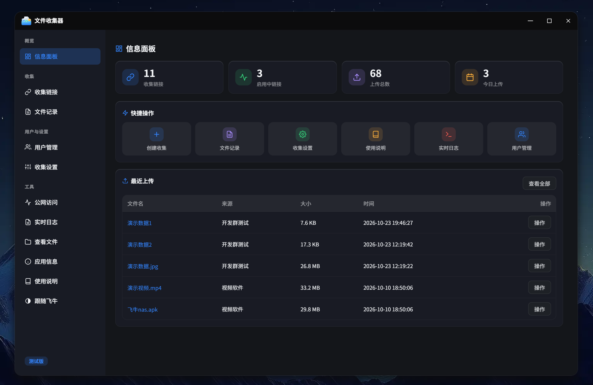

# 文件收集器 (File Collector) 

<p align="center">
  
</p>

<p align="center">
  <strong>基于 Flask + SQLite 的多用户文件收集与分享系统 | 支持 Office/PDF/图片/视频/音频/TXT 在线预览 | 专为飞牛 fnOS 打造</strong>
</p>

<p align="center">
  
  
  
  
  
</p>

<p align="center">
  
</p>

---

## 📖 简介

文件收集器是一个功能完备的轻量级 Web 应用，支持**多用户体系**、**多媒体在线预览**和**双模式分享**。管理员可在后台创建多个独立的收集链接，每个链接自动生成**收集页**（上传）和**分享页**（浏览下载）两种模式——两者拥有**各自独立的通行证**（可分别设为密码保护或公开访问），以及独立的上传限制、有效期和自定义短链接。支持上传者身份识别、按上传者分文件夹存储，0.01-64 GB 大文件断点续传（TUS 协议）。内置邀请码注册系统，支持管理员和普通用户两种角色。支持 **Office 文档（DOCX/XLSX/PPTX/CSV）** 基于 OnlyOffice WASM 纯前端渲染、PDF（PDF.js 官方渲染）、图片、视频、音频、TXT（小说阅读器）在线预览，所有预览均为离线本地处理，文件不上传第三方服务器。非常适合团队协作、作业收集、资料汇总、文件分发等场景。

**适用平台：** [飞牛 fnOS](https://www.fnnas.com/) **独占** Native 应用（.fpk 格式），不支持 Docker 部署（已停止更新）。支持 **x86 / ARM** 平台。

---

### 🚀 快速导航

| | | |
|------|------|------|
| [✨ 功能特性](#✨-功能特性) | [⚡ 快速开始](#⚡-快速开始) | [💡 使用场景](#💡-使用场景) |
| [🏗️ 技术架构](#🏗️-技术架构) | [📂 收集与分享](#📂-收集与分享) | [🔌 API 文档](#🔌-api-文档) |
| [🌍 环境变量](#🌍-环境变量) | [📋 更新日志](#📋-更新日志) | [❓ 常见问题](#❓-常见问题) |

> 提示：点击上方链接可直接跳转到对应章节。

---

## ✨ 功能特性

### 🎯 核心功能

| 功能 | 说明 |
|------|------|
| 👥 **多用户系统** | 支持管理员与普通用户角色，邀请码注册，用户启用/停用/编辑/重置密码 |
| 📄 **PDF 预览** | PDF.js 官方渲染，支持缩放/旋转/搜索/缩略图/大纲导航 |
| 📝 **Office 预览** | DOCX/XLSX/PPTX/CSV 在线预览，OnlyOffice WASM 纯前端渲染，离线本地处理 |
| 📖 **小说预览** | TXT 文本在线预览，章节自动识别、暗色/亮色主题、字号行宽可调 |
| 🔗 **多链接管理** | 创建/编辑/启用/禁用/删除，支持**自定义短链接 ID**（3-32 位字母数字） |
| 🔑 **双通行证** | 收集页和分享页各自独立的通行证，分别可设为密码保护或空通行证（公开访问） |
| 🔓 **公开收集** | 勾选「空通行证」即可开放公开访问，无密码也可上传/下载 |
| 📤 **文件收集** | 多文件拖拽 + 点击上传，进度条实时显示，支持 TUS 断点续传大文件 |
| 📥 **文件分享** | 同一链接生成分享页（只读模式），可浏览和下载文件，按上传者登记展示 |
| 👤 **上传者身份** | 要求上传者填写昵称，按上传者分文件夹存储，每人独立上传配额 |
| 🎬 **多媒体预览** | 图片/视频/音频在线预览，支持 jpg/png/gif/webp/heic/mp4/mov/mp3/flac 等 |
| 📏 **文件限制** | 自定义单文件大小上限（0.01-64 GB）和上传数量上限（0=不限制） |
| ⏱️ **有效期控制** | 收集页和分享页各自的独立有效期，到期自动失效 |
| 📋 **上传历史** | 收集者和管理员均可查看/下载/预览已提交文件 |
| 🗑️ **文件管理** | 上传者可删除自己的记录，管理员支持批量删除 |
| 🎫 **邀请码系统** | 管理员生成邀请码（可设有效期），用户凭码注册 |
| 📦 **数据备份** | 一键下载/导入 SQLite 数据库，自动验证和备份旧库 |
| 🔒 **安全防护** | CSRF 保护、登录频率限制、通行证验证速率限制、会话安全、危险文件拦截 |
| 📱 **响应式 UI** | 桌面和移动端完美适配，微信浏览器自动提示跳转；网关面板窄屏表格自动转卡片，手机端底部 Tab + 抽屉 |
| 🖥️ **统一网关面板** | 集成于飞牛桌面入口的单页管理面板，明暗主题自适应，移动端底部 Tab + 「更多」抽屉 |
| 🎨 **深度定制** | 自定义站点标题、登录提示、页尾文字、首页开关、公网网址 |

### ⚙️ 管理后台

提供两种入口，**数据完全互通**：

**① 飞牛统一网关面板（推荐）** — 从飞牛桌面应用图标进入的集成管理面板，跟随系统明暗主题，移动端自动切换为底部 Tab 栏 + 「更多」抽屉：

- **📊 信息面板** — 图标化总览统计（收集链接 / 活跃链接 / 上传总数 / 今日上传，桌面四列、移动两列）+ 快捷操作图标格（创建收集 / 文件记录 / 收集设置 / 说明，管理员含日志与用户管理）+ 最近上传（同目录文件夹聚合）
- **🔗 收集链接** — 创建、编辑、启停、删除、复制收集/分享链接、自定义短链接 ID（支持中文拼音）、独立通行证与分享页设置
- **📋 文件记录** — 分页浏览、按链接过滤、批量删除、在线预览与下载（窄屏自动转卡片布局）
- **👥 用户管理** — 用户列表、编辑/启停/重置密码/删除（至少保留一个管理员）、邀请码管理
- **⚙️ 收集设置** — 账号与密码、页面与品牌、默认上传参数、上传路径、功能开关、邮件（SMTP）、数据库备份与恢复
- **🌐 公网访问** — 反向代理启停、证书配置、端口检测
- **📜 实时日志** — 操作日志 / 反向代理日志
- **ℹ️ 应用信息** — 版本、数据库路径、上传目录、监听端口、版本更新检测
- **📖 使用说明** — 内置图文教程（跟随明暗主题）

**② TCP 直连后台（`/admin`）** — 通过 `http://[NAS_IP]:端口/admin` 访问的传统多页后台，在未经飞牛统一网关时使用，功能与网关面板一致。

---

## ⚡ 快速开始

### 📦 fnOS 应用商店安装

1. 下载 `.fpk` 安装包
2. 在 fnOS 应用管理中点「手动安装」，选择 `.fpk` 文件
3. 安装向导中填写管理员**账号、密码、昵称、邮箱**（四项均为必填）及**监听端口**（默认 5557）
4. 安装完成后，在飞牛桌面点击「文件收集器」图标打开**统一网关管理面板**；也可访问 `http://[NAS_IP]:端口/admin` 使用传统后台

> 💡 **端口可自定义**，安装时自由选择。如需外网访问，建议配合 Nginx/Caddy 反代使用。

> 🔄 **升级说明**：在应用商店中点击升级即可，数据自动保留。升级向导会自动预填当前端口号。

### 🚪 首次使用

1. 从飞牛桌面打开「文件收集器」管理面板（或访问 `/admin`），使用安装时设置的账号密码登录
2. 前往「收集链接」→ 创建第一个收集链接
3. 复制收集链接或分享链接，发送给目标用户

### 🔐 默认账户

| 用户名 | 密码 |
|--------|------|
| `admin` | `admin123` |

> ⚠️ 首次登录后请立即修改密码！

---

## 🏗️ 技术架构

```
file-collector/
├── app/
│   ├── server/
│   │   ├── app.py                   # Flask 主应用（路由、数据库、旧后台 /admin 业务）
│   │   ├── admin_services.py        # 网关面板业务逻辑（与请求无关的纯函数）
│   │   ├── gateway_admin_api.py     # 网关面板 JSON API（独立 Blueprint，/gateway/admin）
│   │   ├── gateway_api.py           # 飞牛统一网关反代管理 API（独立 Blueprint）
│   │   ├── gateway_guard.py         # 网关来源判定与访问守卫
│   │   ├── rproxy_manager.py        # Go 反向代理管理器（HTTPS + HTTP→HTTPS 301）
│   │   ├── cert_manager.py          # 飞牛证书管理模块
│   │   ├── office.py / pdf.py / txt.py   # 各预览渲染模块
│   │   ├── templates/
│   │   │   ├── gateway.html         # 统一网关集成面板（单页）
│   │   │   ├── gateway/             # 面板各 Tab 片段（dashboard/links/records/users/settings）
│   │   │   └── admin_*.html         # 旧后台（TCP 直连）模板
│   │   ├── static/
│   │   │   ├── css/                 # 含 gateway.css、gateway-admin.css
│   │   │   └── js/
│   │   │       ├── gateway-admin.js # 网关面板框架（模态框 / 气泡 / API 封装）
│   │   │       └── gateway-admin/   # 各 Tab 脚本（gw-dashboard / gw-links / gw-users…）
│   │   └── office/                  # OnlyOffice WASM 静态资源（离线预览）
│   ├── rproxy/                      # Go 反向代理（编译产物 fc-rproxy-amd64/arm64，源码见 src/ 与 .github/workflows）
│   └── ui/                          # 桌面图标资源
├── cmd/
│   ├── main                         # 生命周期管理（start/stop/status/uninstall）
│   ├── install_init                 # 安装前初始化
│   └── uninstall_callback           # 卸载后清理
├── config/
│   ├── privilege                    # 运行权限配置
│   └── resource                     # 共享目录声明
├── wizard/
│   └── install                      # 安装向导配置
├── manifest                         # 应用元信息
├── logo.png                         # Logo
└── README.md
```

| 组件 | 技术 | 说明 |
|------|------|------|
| Web 框架 | Flask 3.0.0 | 路由、模板渲染、会话管理 |
| 数据库 | SQLite（WAL 模式 + 外键约束） | 零配置、高性能并发读写 |
| 密码哈希 | Werkzeug Security | bcrypt 级别安全存储 |
| 断点续传 | TUS 协议 | 5MB 分片 + 3 并发 + 自动恢复 |
| PDF 预览 | PDF.js (Mozilla) | 官方渲染引擎，缩放/搜索/旋转 |
| Office 预览 | OnlyOffice WASM | 纯前端渲染 DOCX/XLSX/PPTX/CSV，离线本地处理，零网络依赖 |
| TXT 预览 | 自研小说阅读器 | 章节识别、黑暗/明亮主题、字号行宽调节 |
| 生产部署 | Gunicorn | 多 worker 进程，Nginx 反代 |
| Python | 3.11+ | 飞牛 fnOS 系统原生内置 |
| 离线安装 | Wheel 预编译包 | x86 + ARM 双架构，零网络依赖 |

---

## 📂 收集与分享（双模式）

每个链接自动生成两个独立页面，两者拥有**各自的配置**：

| 属性 | 收集页 | 分享页 |
|------|--------|--------|
| **地址** | `/collect/<id>` 或自定义 slug | `/share/<id>` 或自定义 slug |
| **用途** | 文件上传 | 文件浏览与下载 |
| **独立开关** | `collect_disabled` 复选框 | `share_enabled` 开关（默认关闭） |
| **通行证** | 单独设置密码或空通行证 | 可设独立密码、空通行证，或**回退复用**收集页密码 |
| **有效期** | 独立到期时间 | 独立到期时间 |
| **自定义 ID** | 3-32 位自定义 slug | 3-32 位自定义 slug |
| **描述** | 独立描述文本 | 独立描述文本 |

### 🔑 通行证体系

```
分享页独立通行证  →  已设置则使用
       ↓ 未设置
分享页空通行证    →  已勾选则无需密码
       ↓ 未勾选
复用收集页通行证  →  fallback 到收集页密码
       ↓ 未设置
收集页空通行证    →  已勾选则公开访问（无需密码）
```

- **空通行证（公开收集）**：勾选后链接完全公开，访问者无需输入任何密码即可上传或下载
- **密码通行证**：输入密码验证后，在可配置的有效期内免重复输入
- **通行证缓存**：收集页和分享页的验证状态各自独立（不同 session key），互不干扰
- **安全令牌**：公开链接（无通行证）的下载/预览自动附带 HMAC-SHA256 签名令牌，15 分钟有效期，防止盗链直连

### 🔗 自定义链接 ID

除了系统自动生成的 8 位 UUID 短 ID，创建链接时可自定义更具辨识度的短链接：

- **规则**：3-32 位，字母数字 + `-` `_`，以字母或数字开头
- **示例**：`/collect/team-photo`、`/share/monthly-report`
- 收集页和分享页可分别设置不同的自定义 slug
- 系统保留字（`admin`、`api`、`login` 等）不可使用

### 👤 上传者身份

开启「上传者」功能后：

- 访问者需先填写昵称（中文 2-8 字 / 英文数字 3-20 字符）才能上传
- 文件按上传者分文件夹存储：`<链接文件夹>/<上传者昵称>/`
- 每个上传者享有**独立的上传数量配额**（不与其他上传者共享限额）
- 分享页会将所有文件按上传者登记为折叠面板，一目了然

### 📤 大文件断点续传

- 超大文件自动启用 **TUS 协议分片上传**（5MB 分片，3 并发）
- 支持断点续传：网络中断后自动恢复，无需重新上传
- 单文件上限 0.01-64 GB，硬限制 64GB（Flask `MAX_CONTENT_LENGTH`）
- 上传进度条平滑动画，速度 EMA 平滑显示

---

## 🌍 环境变量

| 变量 | 用途 | 默认值 |
|------|------|--------|
| `DATA_DIR` | 数据库存储目录 | `$TRIM_DATA_SHARE_PATHS/data` |
| `UPLOAD_BASE` | 上传文件存储根目录 | `$TRIM_DATA_SHARE_PATHS/uploads` |
| `PORT` | 监听端口 | `5557` |
| `FLASK_DEBUG` | 调试模式 | `0` |

> **数据库持久化：** 使用 `TRIM_DATA_SHARE_PATHS`（飞牛官方应用文件目录），安装时自动分配，更新/重装不会丢失数据。

---

## 💡 使用场景

| 场景 | 配置建议 | 操作流程 |
|------|---------|---------|
| 📚 **作业收集** | 开启上传者身份，每人独立配额 | 老师创建链接 → 发送到班级群 → 学生填写姓名上传 → 分享页按姓名分组查看 |
| 📄 **资料汇总** | 大文件限制可调至 64GB | 创建收集链接 → 团队上传文档/视频 → 管理员集中下载 |
| 🔗 **文件分发** | 开启分享页，设为公开访问 | 上传文件到链接文件夹 → 分享链接给接收方 → 对方浏览下载 |
| 🏢 **客户交接** | 设置独立通行证 + 有效期 | 创建专用链接 → 客户凭密码上传 → 到期自动失效 |
| 📸 **活动照片墙** | 不限文件数，分享页预览开启 | 参与者扫码上传 → 分享页实时浏览 → 支持在线预览 |
| 🔒 **内部文件共享** | 收集页 + 分享页双通行证 | 管理员上传文档 → 内部员工凭密码访问分享页下载 |

---

## 🔌 API 文档

### 💚 健康检查

```bash
GET /api/status
```

响应示例：
```json
{
  "status": "running",
  "db_ok": true,
  "upload_dir_exists": true
}
```

### 📤 收集页

| 方法 | 路径 | 说明 |
|------|------|------|
| `GET` | `/collect/<link_id>` | 收集页面（通行证 + 上传） |
| `POST` | `/collect/<link_id>/verify` | 验证通行证 |
| `POST` | `/collect/<link_id>/logout` | 退出通行证 |
| `POST` | `/collect/<link_id>/upload` | 上传文件（multipart） |
| `GET` | `/collect/<link_id>/records` | 获取上传历史（JSON） |
| `GET` | `/collect/<link_id>/download/<record_id>` | 下载已上传文件 |
| `GET` | `/collect/<link_id>/preview/<record_id>` | 在线预览文件（图片/PDF/视频/音频/TXT/Office） |
| `GET` | `/collect/<link_id>/preview_file/<record_id>` | 获取文件原始内容（JIT SDK 调用） |
| `POST` | `/collect/<link_id>/delete_record/<record_id>` | 删除单条记录 |

### 📥 分享页

| 方法 | 路径 | 说明 |
|------|------|------|
| `GET` | `/share/<link_id>` | 分享页面（通行证 + 文件列表） |
| `POST` | `/share/<link_id>/verify` | 验证通行证 |
| `POST` | `/share/<link_id>/logout` | 退出通行证 |
| `GET` | `/share/<link_id>/records` | 获取文件列表（JSON） |
| `GET` | `/share/<link_id>/download/<record_id>` | 下载文件 |
| `GET` | `/share/<link_id>/preview/<record_id>` | 在线预览文件（图片/PDF/视频/音频/TXT/Office） |
| `GET` | `/share/<link_id>/preview_file/<record_id>` | 获取文件原始内容（JIT SDK 调用） |
| `POST` | `/share/<link_id>/delete_record/<record_id>` | 删除单条记录 |

---

## 📋 更新日志

### v2.3.112
- **修复「打包下载」得到空包或缺文件（静默跳过导致）**：旧逻辑在上传路径失效、文件已被移动/删除、或路径不在上传目录内时直接 `continue`，用户只能拿到一个少了文件的 ZIP，甚至空包却显示成功。现在会统计被跳过的文件：压缩包内缺文件时**弹出「已跳过 N 个无法读取的文件：xxx」**；选中文件全部不可用时返回明确中文错误，不再下发空 ZIP
- **路径解析更宽容**：同时兼容 `stored_path` 为相对路径、以及 `stored_path` 前缀已失效（例如改过上传路径）但 `stored_name` 仍能定位文件的历史数据；ZIP 内文件名统一取 basename，防止原始文件名带 `../` 造成 zip slip
- **目录视图不再让人误解**：统计文案改为「N 个文件夹（内含 M 个文件）· 当前目录 共 X 个文件」，未勾选时提示「全选只选当前目录」，避免在根目录全选后误以为压缩包漏掉了子文件夹里的文件
- **Windows 本地调试不再堆积临时 ZIP**：响应体发送完毕（或客户端断开）后清理临时文件
- **移动端工具栏精简**：记录页在移动端（≤900px）隐藏「打包下载」「批量删除」和左侧勾选列，不再与链接筛选、统计抢宽度；单条下载/删除与预览不受影响
- **暗色主题侧栏顶部白线**：取消侧边栏在暗色下的 1px inset 液态高光（桌面侧栏与移动端底部 tab 栏同步处理），解决近黑底上那条显眼的细白线
- **反向代理实时日志降噪**：`/static/*` 静态资源与 favicon 被浏览器取消（刷新/切页时的 `context canceled`）不再写入实时日志；后端拒连（`connection refused`）仍照常记录，不会掩盖真实故障

<details>
<summary><b>📜 历史版本（v2.3.111 及更早，点击展开）</b></summary>

### v2.3.111
- **彻底修复「打开文件管理器」不可用（回到 v2.3.93 的可用行为）**：在真实飞牛 NAS 宿主上实测确认——宿主桥方法（`osConnector.methods`，Penpal/postMessage 转发器）**原样透传任意参数**，只接受**字符串路径**：`openFileManager('路径')` ✅ 成功定位目录；`openFileManager({path})` 与无参调用 ❌ 崩溃。v2.3.106~v2.3.110 走的 `osConnector.request(...)` 是**不存在的方法**（宿主桥上只有 `methods`/`config`），导致整条调用链全失败；无参兜底又触发宿主 `undefined.startsWith` 崩溃
- **修复内容**：按 v2.3.93 的语义直调——`openFileManager('目录')` → 兜底 `openFile('文件路径')` → `openFileManager('文件路径')`，全部字符串参数；删除不存在的 `osConnector.request` 路线与无参 `openFileManagerApp` 兜底；失败提示区分「宿主拒绝调用」与「浏览器直连无宿主桥」两种情况

### v2.3.110
- **修复「打开文件管理器」彻底失效（严重）**：v2.3.108 的兜底链最后一步用了 `openFileManager()`（无参），而宿主端 `openFileManager` 同样会对 `undefined` 调 `startsWith` 直接崩溃 → 整条链断掉，点任何入口都打不开文件管理器。现改为兜底优先调用 **`openFileManagerApp`**（SDK 提供的无参接口，宿主端不会因缺参崩溃），确保「至少能把飞牛文件管理器打开」；`openFileManager` 无参调用降为最后一步
- **独立浏览器直连不再做无谓尝试**：`isStandaloneWeb` 为 true 时说明页面不在宿主环境内（没有 host bridge），直接走「复制路径 + 明确说明」兜底，不再触发一串注定失败的控制台报错
- **提示文案更准确**：明确区分「浏览器直连无法唤起（需在飞牛桌面/手机客户端内打开本应用）」与「桌面端已打开文件管理器但暂不支持自动定位目录」两种情况

### v2.3.109
- **修复「查看文件」页操作行按钮贴死**：v2.3.108 新增的「复制路径」按钮与「打开文件管理器」在 inline 布局下间距为 0（两个按钮完全贴在一起）。新增 `.gwa-btn-row` 按钮组容器，统一 8px 间距；移动端整行排布、两按钮等宽、触控高 38px
- **可点击复制路径的视觉提示**：路径文本加虚线下划线与 hover 高亮，明确「可点」

### v2.3.108
- **「点击文件名 → 打开所在目录」按官方 API 真正打通**：依据官方文档 [页面路由](https://developer.fnnas.com/api/page/routing/)（`openFileManager(path: string)` / `openFile(path: string)`），并根据飞牛桌面客户端的报错 `TypeError: Cannot read properties of undefined (reading 'startsWith')` 定位到真正根因——**官方 JS SDK 在 Web 宿主下把路径参数丢了**（`openFileManager: () => Te("openFileManager")`，`openFile` 同样），导致宿主收到 `undefined` 直接崩溃。现改为绕过 SDK 的 web methods，直接用底层 `request` 传参
- **多形态参数兜底**：依次尝试 `openFileManager {path}` → `openFileManager "path"` → `openFile {path}`（打开文件本身，宿主会定位到其所在目录）→ `openFile "path"` → 最后才回退为「只打开文件管理器」并如实提示；命中最快的一次即返回
- **后端补齐 `stored_path`**：记录接口新增文件完整绝对路径字段，供 `openFile` 兜底定位（此前只有所在目录 `stored_dir`）
- **宿主不可用时自动复制路径**并提示，用户可自行粘贴到文件管理器；独立浏览器仍明确提示需在飞牛客户端内打开
- **「查看文件」页同步修好**：「打开文件管理器」按钮改走同一套多形态调用（此前同样被 SDK 丢参数坑到，宿主直接抛 `startsWith` 报错）；新增「复制路径」按钮，路径文本本身也可点击复制，宿主不可用时自动把上传目录路径复制到剪贴板

### v2.3.107
- **修复 v2.3.106 引入的回归：飞牛桌面客户端点文件名误报「不在飞牛客户端中」**：v2.3.106 用 UA（`FNOS/` / `FNAppType/`）判断是否在客户端内，但飞牛**桌面客户端**的 UA 根本没有这两个标记（那是手机 App 才有的），导致本可用的调用被提前拦下。现改为**向 SDK 查询 host bridge 是否可用**（桌面端应用以 iframe 嵌入 fnOS 桌面 → bridge 存在；独立浏览器标签页 → bridge 为 null，SDK 报 `Host bridge is not available`），PC 端与移动端同时修复
- **桌面端优先带路径定位文件目录**：SDK 自带的 `openFileManager` 会丢弃路径参数，现改用底层 `request('openFileManager', path)` 依次尝试字符串参数与 `{path}` 对象参数；host 若接受即可直接定位到目录，不接受则回退为「只打开文件管理器」并如实提示「桌面端暂不支持自动定位到目录」，不再静默失败
- **「查看文件」页的「打开文件管理器」按钮同步走同一套逻辑**（此前同样受 SDK 丢参数影响，只能打开管理器、无法定位到上传目录）
- **独立浏览器直连**：仍会明确提示「无法唤起飞牛文件管理器，请在飞牛客户端内打开本页面」，不再含糊报错

### v2.3.106
- **移动端浮窗放大并完全居中**：详情浮层此前宽度只有 `min(92vw,360px)`，且居中位置按「主内容区」计算（含底部 Tab 偏移），在手机上又小又偏；现改为完全视口居中、宽度 `100vw - 32px`、圆角 16px、正文 14px；模态框、下拉菜单、日志浮层同步放大，浮窗与模态按钮触控高度提升到 40px
- **修复「点击文件名毫无反应」**：根因是飞牛 SDK 的 `openFileManager` 在 Web 端（桌面客户端内嵌 webview）会丢弃路径参数，导致点击后既不定位也不报错。现改为三层兜底——优先按路径定位 → 退化为只唤起文件管理器 → 明确 toast 提示；并新增 UA 判定，不在飞牛客户端内时直接提示「请在飞牛客户端内打开本页面」，不再静默失败
- **新增「打开所在目录」入口**：文件记录操作浮窗与信息面板详情弹窗均新增该按钮（桌面客户端无法定位路径时的可靠入口）
- **移动端文件名收敛可点样式**：不再做成「蓝色 + 600 粗体链接」，改为正文色 + 500 字重，按下/聚焦时才变主色（不加额外角标，保持列表干净）

### v2.3.105
- **移动端界面重构（修「线贴字」「点击不融合」「底部空一截」）**：本轮按 390px 真实截图逐项定位根因，而不是只看数值——
  - 「标题上方的线贴着字」根因是 `.gwa-card` 顶部的 1px 液态玻璃内高光（`inset 0 1px 0 --gw-liquid-hi`）：移动端卡片已与分组融合（padding:0），这条高光正好落在标题正上方。融合态下没有玻璃质感，移动端直接去掉该高光线
  - 「快捷操作」标题上下两条横线根因是每个快捷格自带 1px 描边、4 个并排后连成线；移动端改为无描边、纯底色分块，并固定 3 列（6 项正好两行，不再出现 4+2 空档），hover 只换底色不换描边
  - 「点击时背景色和上面的线不融合」根因是列表行 hover 底色铺满整行却与两端内缩的 hairline 交叉；移动端取消行 hover 底色，改按压态浅蓝反馈
  - 「下边距太多」根因是 `.mac-main` 底部预留 88px，而底部 Tab 实际只有 65px；已收到 77px（Tab + 12px 呼吸）
- **移动端列表行重构：「操作」按钮提到主信息行右上角**：不再独占一行（每行省 40px），文件记录行高 123px → 80px、收集链接 127px → 84px、用户 150px → 100px；主信息行右侧预留 76px，长文件名自动省略不压按钮
- **移动端统计卡改实底**：浅色主题下「半透明白卡 + 白高光 + 5% 描边」等于隐形，四张卡散在白底上没有分组感；改用 fill-0 实底 + 明确描边
- **移动端目录折叠**：使用说明目录收成下拉条，展开后点击条目跳转即自动收起

### v2.3.104
- **移动端间距规范（4 / 8 / 12 三档节奏）**：此前每个面板里 8 / 10 / 14 / 18 四种间距混用，现统一为「页边距 12 → 分组间距 12 → 组内边距 12 → 列表行 10/12 → 行内元素 8」；面板改用 flex `gap` 取代 margin，消除相邻 margin 折叠造成的 8/14 交替（信息面板 / 收集链接 / 文件记录 / 实时日志全覆盖）
- **列表页脚不再「空」**：单页数据时 `.gwa-list-foot` 只剩一行「每页显示」，原来上下各留 14px；现收进 12px 节奏，分页容器为空时直接移除，录入框收窄到 52×28
- **列表行间距统一 + 分隔线修复**：信息面板行内边距 8px、文件记录上 4 / 下 6 的不对称全部归零，改由 `tr` 统一承担 10/12；触屏取消整行 hover 底色（原先铺满整行的底色与两端内缩 12px 的 hairline 对不齐，看起来「线是断的」），改用按压反馈；文件夹行里凭空占位的空勾选列一并移除
- **信息面板卡片上下留白修正**：移动端透明融合卡原为「上 18px / 下 0」，现上下对称
- **使用说明目录改为移动端下拉**：≤640px 时目录收成一条「这一页都有啥」下拉按钮（带旋转箭头），点击展开整块列表，选中条目跳转后自动收起；桌面仍是原来的常驻目录

### v2.3.103
- **信息面板重构：统计卡图标化 + 新增「快捷操作」图标格**：四张统计卡改为「40px 色底图标片 + 数值 + 标签」横向排布（收集链接 / 活跃链接 / 上传总数 / 今日上传分别对应蓝 / 绿 / 橙语义色与新增的紫色，新增 `--gw-violet` 浅深双套令牌）；快捷操作格支持创建收集（直接弹出创建表单）、文件记录、收集设置、使用说明，飞牛管理员额外显示实时日志、用户管理；「快捷操作」「最近上传」卡标题配同族线性图标
- **信息面板自适应重排（PC / 平板 / 手机）**：统计卡桌面四列一行、≤900px 折两列、≤640px 两列并同步收紧图标片与字号；快捷格 `auto-fit` 依容器宽度自动分配每行个数，320px 窄屏不横向溢出；首屏加载态统一包进卡片，与内容态观感一致
- **移动端列表行间线内缩**：`.gwa-table` 行分隔线左内缩 12px，与内容对齐、不通铺卡片边缘，组内首行无线（iOS 列表分隔线惯例），浅色 .05 / 深色 .06 同一令牌

### v2.3.102
- **移动端列表行统一收紧（信息面板 / 文件记录 / 收集链接）**：修复行块间距失调——文件/收集名称列被误纳入 meta 换行流导致每行纵向堆叠 3-4 层（行高 120-150px），统一为「R1 主信息满宽 → R2 meta 灰字流 → R3 操作整行右置」三段式，行高收敛约一半，浅色/深色同构
- **移动端信息面板「最近上传」标题行修正**：「最近上传」与「查看全部」垂直居中，按钮收窄为 28px 高，不再顶行
- **移动端文件记录面包屑条减负**：`.gwa-dirbar` 退掉灰底实条与描边，仅保留轻量胶囊，浅/深主题一致通透
- **信息面板最近上传支持文件夹聚合（参考文件记录页）**：同一存储目录出现 ≥2 个文件时合并为文件夹行（目录名 + 文件数 + 总大小），点击直达文件记录页对应目录；单文件目录保持文件行；PC 端同步生效
- **PC 侧栏移除多余分隔线**：分组标题已承担分层职能，废除「最后一个 tab 后面」的孤立分隔线（分组之间不加分隔线，保持 iOS 设置页式标题分层）

### v2.3.101
- **网关全站接入 iOS 液态玻璃家族（PC + 移动端）**：PC 侧栏改液态玻璃（此前仅移动端）；信息面板卡片 / 统计卡、编辑与详情模态面板（`gwa-modal`）、居中浮窗（`gwa-popover`）统一使用液态玻璃 token（半透底 + blur 饱和增强 + 顶部内高光 + 半像素描边）；移动端底部 Tab 与「更多」抽屉维持既有液态玻璃，全站观感一致；旧浏览器自动降级实色
- **PC 端侧栏垂直列表放松**：新增 iOS 设置页式分组标题（概览 / 收集 / 用户与设置 / 工具），项高 36→40px、项间距 4→8px、内边距放宽；移动端 Tab 与「更多」抽屉布局保持不变（分组标题移动端隐藏）

- **网关弹层背景统一毛玻璃遮罩（PC + 移动端）**：详情/操作浮窗（`GW.popover`）弹出时页面整体压暗 + 模糊（`--gw-scrim-bg` + blur 14px，淡入淡出 180ms），浮动层成为第一视觉层级，解决居中浮窗与页面内容层级混乱的问题；同步覆盖：编辑/确认模态（`gwa-overlay`）、移动端「更多」抽屉遮罩——全部换用同一玻璃 token；旧浏览器自动降级

### v2.3.100
- **紧急修复：访问网关页面可能卡死浏览器**：v2.3.99 引入的「液态胶囊游标」MutationObserver 脚本存在主线程卡死风险，整段撤销；移动端 Tab 选中态改由纯 CSS 静态液态胶囊底承担（观感不变，无 JS 依赖）
- **优化 PC 端侧栏列表间距过紧**：项高 36→38px、项间距 4→6px、上下内边距微调；移动端底部 Tab 不受影响（其样式在 640 断点内独立覆盖）

### v2.3.99
- **移动端底部 Tab 栏升级 iOS 液态玻璃（Liquid Glass）**：新液态玻璃 token（浅/深双套）——更通透底色 + 折射级模糊饱和 + 顶部内高光条 + 半像素描边；选中 Tab 变为「液态胶囊游标」随切换滑动（带回弹曲线，MutationObserver 驱动，无 JS 时退回静态胶囊底）
- **「更多」抽屉同步液态玻璃**：面板改为通透玻璃（圆角加大到 22px、顶部泛光内高光），抽屉内各功能项改为玻璃胶囊，按压微缩反馈；背景遮罩模糊饱和度同步提档；旧浏览器自动降级实色

### v2.3.98
- **修复弹窗开着切 Tab 后残留不清**：浮层（详情/操作 popover）切 Tab 会自动关闭，但编辑、详情、下载/上传记录等模态弹窗此前不会；现切换 Tab 时统一清理所有浮层（模态/遮罩/浮层/灯箱），松手即干净

### v2.3.97
- **移动端底部 Tab 与「更多」抽屉重新分配**：「公网访问」收入抽屉，「使用说明」上移为第 4 个主 Tab（与桌面对换）；抽屉内对应位置换成「公网访问」，切换后「更多」Tab 高亮同步
- **修复移动端信息面板「最近上传」文件名过粗**：卡片主信息字重 600 降为 500，与整体卡面更协调（文件记录/收集链接页保持不变）

### v2.3.96
- **修复移动端「更多」抽屉显示异常**：抽屉原本嵌套在底部 Tab 栏元素内，v2.3.94 给 Tab 栏加毛玻璃（`backdrop-filter`）后成为 fixed 后代的包含块并把抽屉裁剪进 64px 高的 Tab 栏，点「更多」抽屉只露一条边；现将抽屉移出 Tab 栏、与侧栏同级，恢复全屏弹出
- **修复移动端底部 Tab 选中背景块上下间距不一致**：Tab 圆角块的上下外边距统一为 6px（原上 4px/下 8px 不对称）
- **浮窗遮罩与居中改为只参照主内容区（PC + 移动端）**：毛玻璃遮罩、居中弹窗、编辑模态的范围改为「PC 侧栏右侧 / 移动底部 Tab 上方」的主内容区——侧栏与底部 Tab 栏保持清晰正常显示，不再被毛玻璃覆盖；弹窗居中也不再以整屏（含侧栏）为基准；移动端浮窗限高同步扣除 Tab 高度
- **信息面板最近上传：点击文件名打开所在目录**：与「文件记录」页一致，点击最近上传的文件名直接打开飞牛文件管理器并定位到该目录

### v2.3.95

### v2.3.94
- **统一网关详情弹窗屏幕居中 + 毛玻璃**：链接详情/记录详情等 `gwa-popover` 浮窗不再贴着操作按钮弹出，改为屏幕居中（PC + 移动端统一），背景换半透明玻璃底（.72 + blur 20px 饱和增强），长内容限高 84vh 可滚动，旧浏览器自动降级实色
- **统一网关移动端底部 Tab 栏毛玻璃化**：侧栏 Tab 用半透明玻璃底 + 轻投影抬升，按压/选中项改圆角 pill（更贴移动 APP 观感）
- **修复实时日志出现「后端暂不可达: GET /api/scan-status」**：rproxy 降噪名单补上后台扫描状态轮询接口（此前只有 check-update/logs），后端重启瞬间的轮询失败不再刷日志

### v2.3.93
- **修复老后台上传记录面包屑文字偏上**：`.record-dirbar` 原来用 `padding-bottom:4px` 使文字内容盒上间隙 0px、下间隙 4px（视觉靠上约 2px），改为上下均等的 `margin:4px 16px`，PC 与移动端面包屑均垂直居中

### v2.3.92
- **文件记录列表改为统一时序排序（双端）**：统一网关「文件记录」与老后台 `/admin/records` 的文件夹分组不再全部前置，改为文件夹取其内最新上传时间与散文件一起按时间交错排列（文件夹-文件-文件夹-文件…同刻文件夹在前）；目录浏览/分页/批量操作逻辑不变
- （v2.3.91）修复统一网关文件记录「打包下载」文件名变成 `_.zip`：`GW.downloadBlob` 解析 `Content-Disposition` 优先取 `filename*=UTF-8''`（RFC 5987），下载恢复「文件收集_批量下载.zip」

### v2.3.90
- **顶栏/底栏统一透明毛玻璃（双端、深浅主题）**：老后台 `header`/固定 `footer` 与收集/分享页 `cp-topbar`/`collect-page-footer` 均改用半透明玻璃 token（.92→.78）加饱和度增强的 backdrop-filter；修复深色主题下被 `!important` 换成不透明背景、毛玻璃失效的问题；不支持 backdrop-filter 的旧浏览器自动降级为近实色背景保证可读性
- **修复网关用户管理浮窗「最后一个管理员」提示双显**：禁用/删除拦截原因相同时合并为一条提示（此前同屏出现两条「至少需要保留一个管理员…」）

### v2.3.89
- **过期链接统一显示「已过期」（双端）**：统一网关收集链接面板与老后台 `/admin/links` 的「收集/分享」徽标在有效期到期时显示「已过期」（橙/红），不再与手动停用的「已停用」混为一谈；老后台「更多操作」弹层状态文本同口径
- **老后台头部「主题切换」按钮位置修正**：移到「退出」按钮之后，紧贴成组、间隔 ~10px（去掉右侧过度推开的大空隙）；窄屏（≤640px）用户名限宽+收紧间距防换行

### v2.3.88
- **老后台 `/admin/links` 分享/收集徽标状态口径对齐统一网关**：补齐「分享页自身有效期已到 → 已停用（红）」分支、链接已过期的「随链接停用」「已停用」判定（此前已过期的链接 status 仍为 active，徽标错误显示已开启/已启用）
- 表格行与「更多操作」弹层的状态文本均按「enabled 手动启停 + 到期」双口径判定，与网关 `_link_is_expired` 派生一致；过期时钟图标 title 补「（已过期）」提示并转红

### v2.3.87
- **修复统一网关下文件类型图标 404**：老后台 `/admin/records` 与统一网关面板的图标 URL 均改为按访问形态自动带网关前缀（`X-Forwarded-Prefix → script_root` 判定，TCP 直连不带前缀），与收集页/分享页 `fc_base` 同一机制
- **修复 `/admin/records` 刷新瞬间大图标闪现（FOUC）**：`admin-records-inline.css` 原来渲染在页面末尾（非阻塞、后加载），刷新首帧内联 SVG 以无约束尺寸闪现——移入 `<head>` 渲染阻塞区根治
- 统一网关面板（gw-records.js）图标路径同样接入「仅经网关才拼前缀」约定（与 gateway-admin.js effectivePrefix 一致）

### v2.3.86
- **「创建收集」按钮的「＋」改为内联 SVG 图标并真正居中**：原先全角＋字符受字体基线影响总有偏移，SVG 由弹性盒精确垂直居中；右下角 FAB 圆钮同步改用同一 SVG（消除双图标隐患）
- **移动端按钮尺寸三层收敛**（消除 32/34/36/38/40 混杂的膈应感）：
  - 列表行内操作按钮：32px 统一
  - 工具栏与卡片底部表单按钮（保存/发送测试等）：38/36→34px
  - 弹窗底部按钮：40→36px
  - 文件选择器与同行按钮同步 34px 等高
- 移动端全站输入字号审计：全部 ≤14px（分享设置天数/展示框为弹窗内输入，v2.3.85 已覆盖）

### v2.3.85
- **收集设置「数据导入」行高度对齐（移动端）**：文件选择器（32px）与旁边红色导入按钮（38px）高低不齐——移动端文件选择器统一 38px，同一行内等高
- **移动端表单输入字号回调 16→14px**：与 PC 表单同级、与正文节奏一致（页面 viewport 已禁缩放，聚焦不再有字号膨胀感）；覆盖设置页/工具栏搜索/弹窗/抽屉内全部输入控件
- 深浅双主题、桌面端布局不受影响

### v2.3.84
- **收集链接行字段对齐修复（移动端）**：「分享/收集（状态徽章）」比纯文本字段大一圈且垂直不居中——列表单元格统一垂直居中，徽章在卡片 meta 流中收紧为 20px 高、11px 字号，与灰字同节奏
- **移动端排版节奏整体打磨**：
  - meta 字段字号 12→13px（11px 标签 + 13px 值，层次更清晰）；行内边距 3px→4px 增加呼吸感
  - 名称行提级：收集名称/用户名/邀请码/文件名 15px、信息面板 14px（600 加粗）
  - 行内操作按钮触控目标统一 30px（此前 26px 偏小、误触率高）
- 深浅双主题与桌面端布局不受影响（新规则全部锁在移动断点内）

### v2.3.83
- **修复收集设置「单文件上限」表单布局 bug**：自绘下拉 wrapper 在 flex 行内不再通用 100% 宽（导致并排数字输入被压缩成一条缝），单位下拉固定 76px 取位、输入框恢复弹性拉伸
- **移动端表单统一「填充态」**：输入框/下拉触发器/文本域一律填充底+无边框（app 常规形态），聚焦切白底+主色描边
- **信息面板统计卡配色令牌化**：不再复用禁用态底色，改 `--gw-fill-0`，浅色为白卡上的柔和灰、深色为亮面，双主题内聚
- **移动端更多抽屉隐藏「主题切换」项**：移动端跟随飞牛/系统主题即可（用户反馈）
- **移动端工具栏右侧动态统计独立成行**：「共 N 个 · 第 x/y 页」不再与左侧按钮/筛选挤行错位
- 用户管理搜索框随填充态统一外观

### v2.3.82
- **「＋ 创建收集」FAB 图标正居中**：圆钮改弹性盒（水平+垂直均居中），「＋」不再偏位
- **下拉触发器与工具栏按钮等高**（36px 对齐），消除工具栏里按钮与下拉参差的割裂感
- **深色主题下日志面板 Tab 选中态强化**：选中项提为下一级亮面（白 12% 亮层）+ 白字，不再「选中了看不出来」
- 弹窗内动态创建的下拉（大小单位 MB/GB 等）复验自绘组件接管正常；全站 5 个下拉 0 漏网

### v2.3.81
- **gateway 自绘下拉组件（PC + 移动端统一）**：新增 `gateway-select.js` —— 原生 `<select>` 隐藏保留（提交/业务逻辑不变），在其上构建自绘触发器 + 选项浮层（卡片底、阴影、hover 态、选中态主色勾、键盘方向/Enter/Esc 支持、动态选项实时读取、MutationObserver 自动接管新渲染的下拉）；点开后的选项列表不再是系统原生弹层
- **双端表单形态统一**：消除「移动端 20px 全圆 / PC 端 8px」的割裂——移动端下拉与输入框回归与 PC 同款 8px 圆角 / 40px 高度（输入框保留 16px 字号防 iOS 聚焦缩放）；浮层用固定定位 + 上/下翻转兜底（滚动容器裁剪应对），滚动/点击空白/Esc/窗口缩放即关闭

### v2.3.80
- **gateway 表单控件全端自绘（PC + 移动端均不再使用原生外观）**：输入框/下拉/文本域统一 `appearance:none`，下拉箭头改自绘 chevron（非原生箭头）；数字输入去掉原生上下箭头；表格批量选择复选框自绘（16px 圆角方块+主色勾选态）；textarea 解除高度锁定改自适应多行
- **修复移动端「点击时圆角变直角」的割裂**：WebKit 聚焦重绘会重置控件外观，focus 态显式重申圆角（输入框 12px / 下拉胶囊 20px），并清除原生 focus 直角描边——按压/聚焦前后形状保持一致

### v2.3.79
- **gateway 移动端列表恢复字段标签**（用户反馈「没标题，不知道内容是什么」）：最近上传/文件记录/收集链接/用户管理的 meta 字段重新带上字段名（11px 灰字标签 + 值），名称列与操作列保持无标签；文件夹行「3 个文件 1.8 MB」补间隔，读得出两个含义
- **更多抽屉细节**：底部版本号按批注隐藏；「切换主题」点击后抽屉自动收起（此前仅各导航项收起）
- **底部 Tab 栏按压/选中背景上下铺满**：去掉容器内边距，条目高 56px
- 实时日志面板的筛选下拉/搜索框沿用上一版胶囊化规则（用户看到的仍是旧缓存页面）

### v2.3.78
- **gateway 移动端原生控件 APP 化**（PC 端不变）：筛选下拉、证书域名下拉改「填充态胶囊 + 右侧 chevron」（点击仍弹系统选择器，外观与 app 一致）；搜索框、端口输入等输入框统一填充态圆角块（42px、聚焦主色描边）；工具栏中筛选控件独占一行（操作按钮一行 / 筛选一行，层次清晰）；分页收敛为「‹ 页码 ›」居中并隐藏桌面参数「每页 N 条」
- **修复触屏粘贴灰块**：触屏设备不再渲染按钮 hover 底色（仅真鼠标设备保留），全局清除系统触摸高亮块；按压反馈改透明度变化

### v2.3.77
- **修复前端改动在用户端不生效的死锁**：静态资源由 7 天强缓存改为协商缓存（`no-cache` + ETag/304）—— 版本号冻结后 URL 不再变化，强缓存导致手机 WebView 普通刷新永远命中旧文件（WebView 无硬刷新入口）；现在每次刷新向服务器校验，内容变即新、未变走 304 省流量
- **gateway 移动端重构为原生 APP 分组列表**：条目从「每条一张孤立小卡」改为连续排布 + hairline 细分隔线（整面板一张列表载体），行高压缩；文件夹行并入列表；行右端操作与工具栏按钮 ghost 化为主色文字动作；「＋ 创建收集」升级为右下角悬浮圆钮（FAB）；页头改 app 大标题；深浅双主题令牌驱动
- gateway PC 端布局不变（全部新规则锁在移动/中屏断点内，桌面逐项复核零回归）

### v2.3.76
- 主题默认「自适应设备」强化：无历史偏好即跟随系统暗色（收集/分享页还优先跟随飞牛 fnOS 主题），老后台补齐 fnOS 检测；首帧主题脚本的异常兜底也按设备偏好解析（此前固定落回浅色）

### v2.3.75
- 主题切换按钮改为**纯图标**：月亮/太阳/半填充圆随状态变化，按钮收紧为 27×24px 小方块；悬停 `title` 提示与 `aria-label` 朗读保留（循环仍为 自适应 → 深色 → 浅色）

### v2.3.74
- 主题切换控件由「三段式按钮组」改为**单按钮循环**：自适应 → 深色 → 浅色 → 自适应，图标与文字随当前状态变化

### v2.3.73
- **老后台（TCP 直连 `/admin`）、收集页、分享页新增主题模式「自适应 / 深色 / 浅色」**：老后台为首次支持深色；偏好 localStorage 全站共享，URL `?theme=` 参数可控；新增公共脚本 `fc-theme.js`，head 内联脚本首帧防闪烁，系统主题变化实时跟随
- 当时尚为三段式按钮组控件（v2.3.74 起改为单按钮循环）

### v2.3.72
- emoji 文件夹图标加入尺寸控制（表格 15px / 移动端卡片 16px），与文字比例协调

### v2.3.71
- 修复网关记录列表文件夹行「图标与文本不横向对齐」：图标 `vertical-align: middle` 而名称/meta 为默认基线导致混排高低不平，现统一居中（实测三者中线一致）
- 网关记录行 meta 分隔符「·」同步去除（与 v2.3.69 三页处理统一）
- 收集页/分享页文件夹行图标按用户建议从 SVG 换为系统 emoji 📁（SVG 已移除，不再有描边渲染痕迹）

### v2.3.70
- 修复后台登录页**错误提示缺失**：登录失败（「用户名或密码错误」「登录尝试过于频繁」等）原先仅清空表单、无任何反馈——模板未渲染 flash 消息；现于表单上方新增红色提示条，样式与页面统一

### v2.3.69
- 收集页/分享页/后台记录页列表 meta 分隔符「·」全部取消（大小信息改以弹性留白间隔），彻底消除「图标后面有一个点」的视觉歧义；后台记录卡片 meta 同步

### v2.3.68
- 收集页/分享页目录导航条（「全部文件」面包屑）去掉底色、边框与 `10px` 圆角，融入卡片本体，消除外层卡片圆角之上的第二层边
- 定性记录列表图标后的「点」：像素级排查确认文件夹 SVG 路径本身无孤立点，行内唯一点形字符为 meta 分隔符「·」（修复见 v2.3.69）

### v2.3.67
- 修复收集/分享页卡片头去边线不彻底：主题层此前以 `!important` 强制灰底，页面级修改被覆盖；现主题层同步改为透明背景 + 无底部分隔线，深浅主题一致

### v2.3.66
- 网关移动端记录卡片：文件夹行改用与文件行**同款卡片外观**（此前作为分组头无框，与下方带圆角卡片叠加出「上直角下圆角」的错乱观感），内外边距统一
- 收集/分享页「文件列表」卡片头去除灰底与底部分隔线，消除卡片内叠加的「两层边」观感
- 后台目录导航条上下边距对称化（文本垂直居中复核通过）

### v2.3.65（含 v2.3.54 – v2.3.64 迭代汇总）
- 网关面板「收集链接」新增复制快捷按钮
- 网关/后台/收集/分享四处记录列表图标列与名称起线统一对齐
- 收集页/分享页新增面包屑目录导航（全部文件 → 逐级进入子目录、返回上一级）
- 网关「文件记录」与后台 `/admin/records` 页面同构改造（列结构 / 详情浮窗 / 批量操作口径一致）
- 网关记录列表不再显示图片预览缩略图，统一为**扩展名专属图标**映射，列表更紧凑一致
- 记录行图标列统一为 18px 图标 + 6px 文字间距
- 后台记录行图标接入 `file_icon_url` 渲染（桌面/移动一致），文件夹行融入列表背景、文件名可点击弹出详情浮窗
- 文件夹图标造型统一为 Material 风格，小尺寸下不再呈现「三个点」观感

### v2.3.53
- **移动端（≤640px）适配复核与打磨**：全面复核手机端底部 Tab 栏、「更多」抽屉与表格转卡片布局，均无横向溢出；本次把底部 Tab 文字由 10px 放大到 11px 提升可读性，浮窗底部按钮最小高度提到 40px、关闭按钮触控目标放大到 36×36，表单控件字号统一提到 16px（避免 iOS 聚焦时自动放大页面）
- **收集链接浮窗体验优化**：在「创建/编辑收集」浮窗中开启「启用分享页」开关后，内容区会自动滚动到底部，直接完整展示「分享页设置」区块，不再需要手动下拉
- **去掉版本号后的「↗」外链箭头**：信息面板与侧栏版本号统一为纯文本 `v2.3.53`
- **用户管理：管理员账户同样可操作**：此前管理员行操作列显示「—」不可点，现管理员也可执行编辑/禁用/重置密码/删除；删除时**至少保留一个管理员**（最后一个管理员的删除按钮会置灰并提示），且**不能删除当前登录账户**（前端拦截 + 后端校验双重保障）

### v2.3.52
- **修复统一网关面板「文件记录」表格列错位**：表头按整页是否存在上传者决定是否加「上传者」列，而数据行按每条记录各自决定，同页混合两类记录时表头与数据列数不一致，从「上传者」列起整体错位（文件名越长越明显）。现改为逐行对齐（每条记录按同一判据输出单元格），并已用超长文件名验证列偏移为 0
- **修复面板内下载/预览被重定向到旧后台（TCP 直连）页面**：面板复用旧 `/admin/records/*` 下载与预览端点，而这些端点带「管理员仍用默认密码则强制跳转设置页」守卫，导致面板内点下载会跳到旧后台设置页、预览报「加载失败」。现改为**经飞牛统一网关的来源豁免该强制改密跳转**（端口直连行为保持不变），并把面板内下载改为隐藏 iframe 触发，不再导航当前页面；TXT 等预览恢复正常
- **新增响应式自适应**：此前只有桌面（>640px）与手机（≤640px）两态，窄窗口/平板下侧栏固定 220px + 大内边距导致内容区过窄、表格横向滚动严重。现新增两级断点逐级收窄侧栏与主区内边距，并在 ≤900px 时表格自动转为卡片布局（各表格补齐字段标签），实测 360–1920px 多种分辨率下无横向溢出
- **统一网关面板细节优化**：设置页移除「系统信息」卡片（已有独立的「应用信息」页，信息重合）；实时日志默认展示并把「操作日志」前移；去掉「查看 →」「← 返回用户列表」的文字箭头与下载按钮下划线；应用信息、查看文件页的目录路径文字去掉背景底色

### v2.3.51
- **修复统一网关「使用说明」页在飞牛桌面下锚点跳转导致整页上移、主卡片底部贴边**：飞牛桌面以 iframe 嵌入应用页面且存在页面缩放，WebView 执行原生「滚动到锚点」（点击文章目录、带 hash 链接打开/刷新、前进后退）时会滚动 iframe 文档本身，其少量多余可滚量被顶出，整页上移使内容卡片贴住窗口底边。现改由脚本接管全部锚点定位：URL hash 在页面解析前摘除（阻止原生定位），点击目录/带 hash 打开/前进后退均改为仅滚动内容区内部并手动更新地址栏，iframe 文档全程不被滚动

### v2.3.50
- **修复统一网关「使用说明」页点击目录锚点后窗口底部露出浅色条带**：桌面端 html/body 此前未锁定 document 滚动（移动端已锁定），飞牛 WebView 在页面缩放下存在少量多余可滚量，点击文章顶部目录锚点时被浏览器一并滚出，页面整体上移露出 WebView 默认浅色背景。现补齐 `overflow: hidden` 并为 html 增加主题背景兜底，与移动端行为对齐

### v2.3.49
- **修复高危提权漏洞：伪造网关头即可冒充管理员**——应用 SSO 自动登录原先只判断 `X-Trim-Userid` 头是否存在、不校验请求来源，配合应用监听 `0.0.0.0`，任何能访问应用端口的请求只要自行带上该头（外加 `X-Trim-Isadmin: true`）就会被当作飞牛账号**自动建号并授予管理员**。现在 SSO 登录前强制校验应用内部令牌，**仅经本应用 Unix Socket 代理注入令牌的请求才可信**，端口直连与公网反代一律跳过 SSO，漏洞关闭
- **网关管理接口补 CSRF 校验**：统一网关页的**反向代理启动/停止、日志清空**三个 POST 接口原先无任何令牌校验，管理员登录态下可被第三方页面诱导发起操作；现改为校验 `csrf_token`（表单或 `X-CSRFToken` 头），校验失败返回 403，前端同步携带令牌
- **Office / PDF 预览来源判定改用内部令牌**：原先用 `X-Trim-Userid` 头判断「是否经网关」，该头可被端口直连伪造导致误判；现统一改用内部令牌，与网关隔离逻辑保持一致
- **网关权限判断去头化**：统一网关页与后端管理接口原先读取可被伪造的 `X-Trim-Isadmin` 头，现改为以应用会话 `session['is_admin']` 为准
- 📌 本版延续 v2.3.48 的网关安全加固：端口直连 `/gateway` 一律 404、Unix socket 权限由 `0666` 收紧至 `0660`、退出飞牛 NAS 后应用登录态同步失效

### v2.3.48
- **安全加固：统一网关管理页与端口访问隔离**——新增应用内进程级内部令牌，仅本应用的 Unix Socket 代理在转发时注入该请求头（并剥离客户端伪造的同名头），统一网关页面与接口据此判定来源，通过应用端口直连 `http://<NAS>:5557/gateway` 现在一律返回 **404**，不再暴露网关管理面板
- **Unix socket 权限收紧**：`/var/apps/file-collector/target/app.sock` 由 `0666` 改为 `0660`，非应用属主/属组用户无法再直连 socket 获取完整前端
- **修复：退出飞牛 NAS 后应用仍保持登录**——应用会话与飞牛网关 SSO 原本相互独立，会话建立后不再校验网关头；现在经网关的请求会校验 `X-Trim-Userid` 与会话绑定的飞牛账号是否一致，**飞牛已退出或切换账号时立即失效应用登录态**，本地账号（应用密码登录）不受影响
- **安装向导四项必填**：管理员**账号、密码、昵称、邮箱**全部改为必填，缺任一项无法进入下一步；首次安装时昵称/邮箱将一并写入用户表
- **移除「首次访问强制设置昵称」**：安装向导已收集昵称，设置页不再要求必填；同时修复管理员在个人设置页修改密码后，后台设置页校验「当前密码」误报「原密码错误」的问题（改密后同步全局密码哈希）
- **非飞牛管理员的管理类功能全部收敛**：统一网关管理页对飞牛普通账号仅保留「文件收集」与「使用说明」，其余管理 Tab 全部隐藏——**公网访问、反向代理、实时日志、查看文件**（上传目录属于应用数据目录，普通账号在文件管理器中无权限浏览），桌面侧边栏与移动端「更多」抽屉同步隐藏；同时后端对这些管理接口（状态、证书、反代启停、日志、端口检测）增加管理员校验，非管理员直接请求返回 **403**，防止绕过前端隐藏调用
- **修复网关页 JS 语法告警**：`gateway.html` 中内嵌的模板裸表达式改为 `data-*` 属性承载，消除编辑器报出的 JS 语法错误诊断

### v2.3.47
- **设置页新增「单次最多上传个数」**：可单独限制每个收集链接一次最多上传的文件数量，填 `0` 表示不限制，上限 500 个（`BATCH_LIMIT`，收集页文案与限制逻辑同步生效）
- **使用说明图片浮窗**：内置「使用说明」教程中的截图支持点击放大查看——
  - 点击图片以浮窗全屏显示原图，不再只看到缩略图
  - 浮窗提供**关闭按钮**（×）与 `Esc` 快捷键，点击遮罩也可关闭
  - 支持**滚轮缩放**及「放大/缩小/恢复原始大小」按钮，最大 6 倍
- **反向代理提示文案样式优化**：「公网访问」Tab 表单下方的提示文案去除背景与边框，颜色自适应系统明暗主题，行高间距优化
- **rproxy 日志噪音过滤**：减少无意义日志刷屏——
  - 扫描器/老设备 TLS 握手失败（`no cipher suite`、`unsupported versions` 等）静默记录，不再刷 ERROR
  - 反代启动早期后端未就绪（`connection refused`）降级为 DEBUG，仅 `/api/check-update`、`/api/logs` 等高频接口静默，其余降级 DEBUG 记录
- **移除独立使用说明教程**：删除仓库 `doc/` 目录（独立 HTML 教程 + 图片），使用说明已完整内置到统一网关管理页「使用说明」Tab，避免内容重复维护
- **修复**：后台「设置」页「收集附件上限（MB）」输入整数（如 200）保存后误显示为 200.0——整数保持整数、小数保留一位，已存的旧值也会规整显示

### v2.3.46
- **统一网关管理页内置「使用说明」**：桌面侧边栏新增「使用说明」Tab（移动端收纳进「更多」抽屉），内置新手图文教程——安装、首次登录改密码、创建收集链接、上传流程、分享页查看下载、后台管理，全部配有实际操作截图，并跟随系统明暗主题
- 使用说明中的截图资源内置到应用内（`static/img/docs/`），不依赖外网

### v2.3.45
- 首页顶栏昵称优先显示：设置昵称后不再显示管理员用户名（`nickname` 为空时回退账号；SSO 登录仍显示飞牛 NAS 账号名）
- 收集页/分享页标题文案优化：去掉用户名后的逗号，改为「{昵称}邀请您上传文件！」
- 后台链接列表「复制链接」文案同步去掉逗号，与页面展示保持一致

### v2.3.44
- 修复统一网关域名+端口访问时飞牛文档预览（Office/PDF）端口丢失问题：`/docs/preview` 改用根相对路径，由浏览器基于当前页面 origin 解析，端口不再丢失（不再依赖后端从 `X-Forwarded-*` 头还原端口）

### v2.3.43
- 修复统一网关域名访问时飞牛文档预览（Office/PDF）端口丢失问题

### v2.3.42
- **统一网关（`/app/file-collector`）下 Office / PDF 预览支持**：改走飞牛 NAS 自带预览（`/docs/preview?path=<文件绝对路径>`）
- 网关下 Office 预览不再提示「请前往飞牛文件官方应用」，直接跳转飞牛原生预览；`type` 参数覆盖收集页记录（`c`）、分享页记录（`s`）、后台记录（`a`）、收集页附件（`ca`）
- 网关下 PDF 预览同样统一走飞牛 `/docs/preview`，TCP 直连场景保持 OnlyOffice / PDF.js 在线预览不变
- 文件绝对路径从数据库 `upload_records.stored_path` / `links.attachment_path` 取，NAS 访问地址取自网关请求的 `scheme://host` 拼接

### v2.3.41
- **统一网关（`/app/file-collector`）全面适配**：修复后台下载、文件预览（图片/视频/TXT/PDF/音频）、静态资源、后台操作等 URL 缺少前缀的问题
- 修复统一网关下 POST 请求体丢失问题（socket 反代补齐 body 转发），登录/上传/删除/通行证验证等在网关下恢复正常
- 修复统一网关下大文件上传卡死：socket 反代支持 `Expect: 100-continue`，附件上传、TUS 断点续传可用
- 修复统一网关下 PDF 预览资源 404（PDF.js viewer 资源路径适配前缀）
- Office 预览在统一网关下提示「请在飞牛文件官方应用中查看」，TCP 直连保持 OnlyOffice 在线预览
- SSO 网关账号（含飞牛普通账号）首次进入后台强制设置登录密码，设置后可继续使用（飞牛网关免密登录保留）
- 复制分享/收集链接逻辑保持不变（仅通过外网反代或 TCP 端口访问）

### v2.3.40
- 网关页文本优化，消除"公网/本机"入口混淆：
  - 侧边栏 Tab「公网访问」与页面标题统一（原标题「反代状态」更名「公网访问」）
  - 「打开管理后台 ↗」按钮更名「打开公网后台 ↗」，下方注明"通过上方公网地址访问管理后台，外网可用"
  - 内网地址注明"仅局域网（同一网络）内可用"，公网地址注明"可分享给外网用户，通过 HTTPS 加密访问"
  - 「文件收集」Tab 按钮更名「打开后台（本机免密）」，与公网入口明显区分
- SSO 统一网关登录后台时，顶部导航栏显示「飞牛NAS账号：用户名」，不再显示 `|` 分隔符与退出按钮
- 修复网关页移动端状态行布局：地址链接、按钮与说明文字强制换行上下堆叠，间距统一由 `gap` 控制，不再挤在同一行

### v2.3.39
- 网关页新增「文件收集」Tab：点击在新窗口打开后台管理（`/admin`），通过飞牛统一网关 SSO 自动登录，无需输入账号密码
- 飞牛统一网关 SSO 免密登录：网关认证后自动建立应用登录态；首次访问自动创建应用账号并绑定飞牛 UID；飞牛管理员自动映射为应用管理员；SSO 登录隐藏退出按钮（退出 = 退出飞牛系统）
- 网关页 UI 优化：主内容区圆角、按钮尺寸统一、键盘焦点可见性、移动端侧边栏吸顶、区块切换过渡动画、状态行间距、移动端滚动优化、侧边栏溢出渐变提示
- 版本号改为外链，新窗口打开 GitHub 仓库
- 「运行状态」Tab 更名「公网访问」，对应页面标题更名「反代状态」

### v2.3.38
- 修复网关页（gateway.html）暗色主题首屏闪烁：飞牛系统主题获取由 `DOMContentLoaded` 提前到页面渲染前，SDK 初始化与内容加载并行，暗色主题下不再先白后黑
- 主题跟随更实时：应用启动即读取系统主题并应用，原有 `$on('os/theme')` 事件监听与 1s 轮询兜底不变

### v2.3.37
- 优化安装包大小，删除 onlyoffice 不必要的字体文件
- 统一网关页面（gateway.html）移动端深度适配
- 侧边栏移动端改为 3 列网格平铺，全部 Tab 一屏可见，避免横向滑动导致选项不可见
- 侧边栏项移动端居中显示，移除触摸高亮并新增按压反馈
- 移动端隐藏侧边栏分隔线、版本号与反馈区，主内容区内边距优化
- 状态行移动端改为上下堆叠（标签在上、值在下），端口输入行纵向排列、端口状态居中

### v2.3.36
- 网关页新增"查看文件"Tab：点击调用飞牛文件管理器打开上传目录（与 `/admin/settings` 同源）
- 优化网关页主题跟随速度：轮询间隔由 5s 缩短为 1s，加节流防叠加请求

### v2.3.35
- 更新应用图标

### v2.3.34
- 修复主题无法跟随飞牛系统的问题：移除 `prefers-color-scheme` 与 `localStorage` 对主题的覆盖，让飞牛系统主题（SDK）无条件接管

### v2.3.33
- 修复统一网关页面主题自适应：改用飞牛官方 JS SDK（`getPlatformConfig` + `$on('os/theme')`）读取与监听系统主题，替换原有 `body[theme-mode]` 检测
- 新增 `micro_app=true` 声明，并本地化 `@trimjs/web-app` SDK 以保证离线可用

### v2.3.32
- **暗色主题全面重构**：统一 CSS 变量系统，所有页面使用同一套颜色令牌
- **表单输入框修复**：修复暗色模式下 input/select/textarea 背景色为白色的问题，增加浏览器自动填充覆盖
- **按钮样式优化**：统一按钮暗色样式，修复 hover 状态颜色对比度不足
- **浮窗组件适配**：修复用户操作浮窗、链接编辑浮窗在暗色模式下的颜色显示
- **响应式改进**：修复移动端邀请码生成区控件高度不一致问题，统一为 28px
- **代码精简**：删除 admin-inline CSS 中约 1000+ 行冗余暗色模式代码

### v2.3.31
- 修复收集页单文件下载缺少 `expires` 参数导致无通行证时下载失败的问题
- downloadFile 函数现在正确传递 `token` 和 `expires` 两个参数
- 确保公开链接（无通行证）下载时令牌校验通过

### v2.3.30
- 修复 `create_link` 函数中 `allow_download` 变量未定义导致创建链接失败的问题
- 完善下载权限逻辑：确保 create_link 和 edit_link 中都正确处理 allow_download 参数
- SQL 参数校验：CREATE_LINK INSERT 和所有 EDIT_LINK UPDATE 语句参数数量匹配验证通过

### v2.3.29
- 新增收集页下载按钮开关：在创建/编辑收集时可独立开启下载权限（默认关闭），与预览权限分离
- 支持单文件下载：开启下载开关后，文件列表每行显示下载按钮
- 支持批量打包下载：批量选择文件后可打包成 ZIP 下载
- 数据库新增 `allow_download` 字段（INTEGER DEFAULT 0）
- 下载接口权限校验改为检查 `allow_download` 字段，而非共享的 `allow_preview_download`
- 后端新增 `/collect/<link_id>/batch_download` 接口，支持批量打包下载

### v2.3.28
- 收集页上传区文件/文件夹双列分区（拖拽自动识别文件/文件夹）
- 支持上传文件夹并保留完整目录路径
- 修复顶层文件夹路径丢失问题
- 提示信息移出 dropzone 独立区域，断点续传提示默认展开
- TXT 阅读器性能优化：scroll 模式增量渲染、增量切行、TOC 延迟重建、paged 溢出检查批量移除

### v2.3.27
- 修复 v2.3.26 引入的启动崩溃：`SyncWorker` 无 `worker_age` 属性导致所有 worker 启动失败
- 改用 `fcntl.flock` 文件锁确保多 worker 下只一个执行反代自动恢复

### v2.3.26
- 新增反代自动恢复：NAS 重启后自动用上次保存的配置重启反代，无需手动启动
- `post_worker_init` 中第一个 worker 延迟 3s 调用 `auto_recover()`，避免多 worker 重复启动
- `_try_recover_from_state` 优化：进程不存在时不再清除状态文件，保留 config 供自动恢复使用
- 新增 `auto_recover()` 方法：检查状态文件中是否有上次运行配置，Go 进程已死则自动重启
- 启动前检查证书文件是否仍存在，证书缺失则跳过恢复并清除状态

### v2.3.25
- 反向代理稳定性大幅修复，解决运行一段时间后静默停止的问题
- 修复 Go 进程 stdout 管道从未读取，缓冲区满后进程阻塞卡死（核心根因）
- 修复 Python `_drain_stdout` 方法代码断裂导致 `_api_request` 被吞掉，反代无法正常通信
- `WriteTimeout`/`ReadTimeout` 改为 0（不限制），避免大文件上传/下载超时断开
- `handleHTTPRedirect` 添加 10s 读取超时，防止恶意连接阻塞 goroutine
- API Server `WriteTimeout` 改为 0，避免 SSE 日志流被 30s 断开
- `serve()`/`handleConn` 添加 panic recover，防止 panic 导致整个进程崩溃且无日志
- `Start`/`Stop`/`GetStatus`/`ReloadCert` 添加互斥锁，修复并发数据竞争
- `Accept` 连续错误添加退出机制（>10 次退出 + 100ms 间隔），避免死循环
- 新增 `proxy.ErrorHandler`，后端请求失败不再静默
- `_drain_stdout` 将 Go panic/fatal 输出到 Gunicorn errorlog，崩溃原因可追溯
- 修复 `_recovered` 标志永不重置，Go 崩溃后无法重新恢复
- 修复 `start()` 保存状态时 `pid` 可能为 None，导致后续误判反代未运行
- 优化日志噪音：客户端正常断开（context canceled/EOF）降级为 DEBUG，不再记为 ERROR

### v2.3.24
- TXT 阅读器性能优化：scroll 模式增量渲染，只渲染首屏 300 行，滚动接近底部才追加
- 增量切行替代全量 re-split，解决 O(n²) 复杂度
- 章节目录延迟重建，每 10 个 chunk 才更新 TOC DOM
- paged 溢出检查批量移除，减少 reflow 次数（100→20）
- 章节跳转/模式切换后自动追加渲染后续内容

### v2.3.23
- 收集页上传区改为文件/文件夹双列分区，拖拽自动识别类型（文件走普通上传，文件夹走 webkitdirectory）
- 支持上传文件夹并保留完整目录路径（含顶层文件夹名），后端自动创建子目录
- 修复文件夹上传时顶层文件夹路径丢失问题（之前会截断第一层文件夹名）
- 上传区提示信息（支持断点续传/单次上限/续传说明）移出 dropzone 到独立区域，compact/full/上传中状态同步
- 断点续传提示改为默认展开，移除收起按钮和折叠逻辑
- dropzone 样式优化：hover 灰色特效（边框加深+浅灰底）、图标上浮放大、链接 hover 颜色加深无下划线
- 移除历史面板与 tab 标签重复的文件计数文案
- 卡片内边距调整（桌面端上 20px，移动端 15px）

### v2.3.22
- Office 预览修复：CSP 添加 `unsafe-eval`/`wasm-unsafe-eval`，解决 x2t WASM 模块无法实例化
- Office 预览修复：`getInitials`/`hasTabInvisible` 空值崩溃（只读模式下 user/toolbar 未初始化）
- Office 预览修复：拦截 `file:///` 系统字体加载，消除大量控制台错误
- Office 预览修复：禁用 ServiceWorker 注册，消除 SW 更新失败错误
- Office 预览修复：中文文件名被截断（Flask ASCII 回退名问题），支持 `filename*=UTF-8''` 解码
- Office 预览安全：`/office-v/index.html` 禁止直接访问，必须通过 `/doc` 路由权限校验后进入
- Office 预览页面初始标题改为"Office 文件正在加载中"
- 隐藏 OnlyOffice viewer 右下角 FAB 菜单按钮及菜单引导提示
- 网关页侧边栏调整：运行状态移至反向代理上方，微信反馈移至运行状态卡片内

### v2.3.21
- 恢复 Office 文档在线预览（DOCX/XLSX/PPTX/CSV），基于 OnlyOffice WASM 纯前端渲染
- 离线集成，零网络依赖，WASM 本地处理，文件不上传第三方服务器
- 集成思源黑体 + 思源宋体（OFL-1.1 开源字体），中文字体合规无侵权风险
- 新增 `office.py` 模块 + `/doc` 预览路由，复用现有权限校验体系（通行证/HMAC 令牌/归属校验）
- OnlyOffice 静态资源置于 `app/server/office/` 目录，独立管理
- 权限失败时显示友好错误页（与 PDF 预览体验一致）
- OnlyOffice viewer 加载文件失败时前端展示错误覆盖层
- 支持移动端 Office 预览

### v2.3.20
- 网关页 macOS 风格全新重构：侧边栏导航（配置/状态/日志/帮助）+ 主题切换按钮
- 网关页支持亮色/暗色主题切换，自动检测飞牛系统主题（URL/localStorage/body theme-mode）
- 证书列表改为显示全部证书（不再仅显示 used=true），排除 fnOS 内置和 *.fnos.net 动态域名证书
- 移动端登录/注册页样式优化：卡片式布局、圆角输入框、iOS 风格视觉
- 设置页移除「反馈与感谢」卡片及打赏弹窗，清理相关 CSS/图片资源
- 邀请码管理页操作列新增「删除」功能（PC 表格 + 移动端卡片）

### v2.3.19
- 网关页运行状态卡片显示版本号（与 manifest 同步）
- 反馈 Bug 微信可一键复制（CQGGTF）
- Go 反代 TLS 扫描器噪音降为 DEBUG 级别日志
- 同端口 HTTP→HTTPS 重定向启动日志提示
- 修复网关页状态与日志加载不同步问题

### v2.3.18
- 飞牛统一网关（Gateway）：新增独立 Gateway 反代管理页面，集成于飞牛桌面统一网关入口
- Gateway 反代 API：`gateway_api.py` 独立 Blueprint，无需登录（飞牛统一网关已做认证）
- Unix Socket 反代：通过 `gateway_socket = app.sock` 声明，支持飞牛统一网关的反代通道
- 单端口 HTTP→HTTPS 301：Go 反代引擎 TCP 协议嗅探，同端口双协议，明文 HTTP 自动 301 跳转 HTTPS
- HSTS 安全头：HTTPS 响应自动携带 `Strict-Transport-Security`
- SVG 图标全面替换：Gateway 页面 Emoji 图标替换为统一 SVG 图标
- 修复：`gateway_bp` 导入顺序错误导致应用启动失败

### v2.3.17
- **去除 Office 预览**：移除 Word/Excel/PPT 在线预览（JIT Viewer / flyfish file-viewer），简化依赖
- **保留多媒体预览**：PDF（PDF.js 官方渲染）、图片、视频、音频、TXT（小说阅读器，章节识别）
- **TXT 小说阅读器**：暗色/亮色主题切换、字体大小/行宽/行高调节、章节自动检测与侧栏导航、GBK 编码自动识别
- **后台批量操作重构**：`/admin/records` 和 `/admin/links` 采用 `_isBatchMode` / `_selectedIds` Set 模式，默认隐藏复选框
- **批量操作底栏**：固定底栏显示选中数量，打包下载（含等待浮窗）、批量删除（Fetch+JSON）
- **分页缓存修复**：`set_user_setting` 写入后清除缓存，分页链接携带 `per_page` 参数，翻页保持每页条数
- **CSRF 安全增强**：批量删除/批量下载/详情浮窗统一 CSRF 校验，杜绝跨站请求伪造
- **移动端适配**：批量操作栏纵向堆叠、按钮全宽，复选框无批量模式时完全隐藏

### v2.3.16
- 静态资源缓存从 1 天提升到 7 天，大幅加快移动端二次访问速度
- 移除导致移动端加载慢的 CSS `@supports` 键盘修复块（恢复原始 CSS 布局）
- iPhone/移动端禁止所有页面缩放，统一 viewport meta 标签
- PDF 预览 PC/移动端自适应缩放：宽屏用 actual size（100%），移动端自动适配宽度
- 隐藏 PDF 预览工具栏书签按钮（避免 404）

### v2.3.15
- iPhone/移动端禁止所有页面缩放，统一 viewport meta 标签
- 修复 iOS Safari 键盘弹起时页面自动滚动问题（`@supports (-webkit-touch-callout: none)` 限定）
- PDF 预览 PC/移动端自适应缩放：宽屏用 actual size（100%），移动端自动适配宽度
- 隐藏 PDF 预览工具栏书签按钮（避免 404）
- 修复 PDF.js viewer 浏览器缩放问题

### v2.3.14
- 修复公开链接（空通行证）附件下载权限校验漏洞：下载 URL 缺少安全令牌参数导致 401
- 附件下载改用 fetch+Blob 方案，避免浏览器对错误响应弹出"无法提取文件"对话框
- 后端 401/403 错误返回统一为 HTML 错误页面，前端智能提示（令牌过期/需验证通行证）

### v2.3.13
- 反向代理状态持久化：启动状态、配置、证书指纹写入 `rproxy_state.json`，应用重启后自动恢复连接，无需手动重启反代
- 新增端口占用自动清理：启动反代时如检测到端口被旧 fc-rproxy 进程占用，自动杀掉旧进程后再启动
- 修复 `status()` 接口副作用问题：查询状态不再自动启动 Go 进程，改为纯查询
- 前端「检测」按钮自动增强：页面加载/点击检测时自动尝试恢复已运行的反代状态

### v2.3.12
- PDF 预览改用 Mozilla PDF.js 官方 viewer，默认 100% 缩放，彻底解决自适应全屏模糊问题
- 新增 `/pdf` 简洁路由，隐藏内部静态资源路径
- 支持完整的 PDF 浏览功能：缩放、旋转、搜索、缩略图、大纲、下载、打印等
- 清理 office_preview.html 中无效的 PDF 缩放代码

### v2.3.11
- 修复反向代理管理页面联动 Bug：`status()` 接口缺少 `public_url` 字段导致设置页反代卡片不显示域名、缺少 `cert_changed` 字段导致证书变更不提示重载
- 新增证书指纹追踪机制：启动/重载证书时保存 sum，状态接口实时检测飞牛系统证书是否更新
- 安装向导新增醒目黄色警告卡片：首次访问务必使用 IP + 端口直连，不要通过飞牛桌面图标反代打开
- 移除 Windows 平台支持：GitHub Actions 不再编译 Windows 版本、删除 `fc-rproxy.exe`、精简 `rproxy_manager.py` 跨平台代码
- 仅保留飞牛 NAS Linux 平台（x86 / ARM 双架构）

### v2.3.10
- 修复反代缺少 `X-Forwarded-Host` 头导致后台登录后立即被踢回登录页的问题
- 后端 Flask 配置了 `ProxyFix(x_host=1)`，反代漏传原始 Host 头导致 session 和 url_for 域名错误

### v2.3.9
- 放弃 OnlyOffice 庞大的项目集成，继续用 file-viewer 实现 Office 预览
- 反向代理配置页面全新设计：单栏分区布局、操作条同行显示、高级选项 auto-fit 横排
- 反向代理增加外网访问链接（新窗口打开）、日志实时刷新、自动滚动、清除/导出日志
- Gzip 压缩和 HSTS 默认启用，代理超时默认 600 秒，修复超时不重连提示
- 修复 Gunicorn 多 worker 下反代状态丢失：状态持久化到 DB + 端口检测双重保障
- 反代日志改为文件共享存储（DATA_DIR/reverse_proxy.log），跨 worker 实时可见
- 反代日志同步输出到 Python logger，与 app.py 保持一致
- 修复反向代理页 JS 语法错误、escapeHtml 转义缺失、Jinja2 循环变量错误
- 修复 HSTS 功能未实际生效、stop() 时序竞争条件
- 修复卸载时选择「删除数据库」后 DATA_DIR/backups 仍有备份残留的问题

### v2.3.8
- Office 预览全面升级为 flyfish file-viewer，替换 JIT Viewer，支持 PPTX/PPT/DOCX/XLSX/PDF/OFD/MD/CSV/DXF/DWG 等格式浏览器端原生渲染
- XLSX 启用 Web Worker 并行解析，大文件预览不再卡顿浏览器
- `/office` 预览路由增加服务端权限校验，防止后台预览 URL 复制后越权访问
- 所有预览文件类型支持滚动，修复 PDF 预览空白、PPTX worker 404 问题
- 智能中文错误提示遮罩：无权限/令牌过期/文件不存在等场景清晰提示
- 去除预览页 HTML 导出按钮、顶部标题栏，精简预览界面
- 删除失效的 txt_reader.html 模板

### v2.3.7
- 反向代理设置方法弹窗新增 Lucky 反向代理教程（含下载链接）
- 反向代理服务器教程改为分步文字说明，优化排版
- 后台/收集页/分享页统一 logo（logo_fs.png）
- 收集页与分享页 header/footer 样式对齐后台毛玻璃风格
- 优化退出按钮交互：hover 改为蓝色边框+底色的低调样式

### v2.3.6
- 修复分享页 `toggleSelect` 多余参数导致 JS 报错问题
- 修复「显示预览按钮」开关错误控制分享页的问题 — 该开关仅控制收集页，分享页始终显示预览和下载按钮
- 系统设置页「分页设置」卡片合并到「默认设置」卡片中，减少页面碎片化

### v2.3.5
- 增强 HEIC 图片转换路径遍历安全防护
- 全面规范化日志系统，所有日志统一通过 logger 输出
- 清理项目备份文件和无用测试残留，减小安装包体积
- 统一 pillow-heif 离线包版本依赖

### v2.3.1
- 修复收集页/分享页音频文件无法预览问题（后端返回 `as_attachment=False`）
- 修复分享页音频文件不显示预览按钮问题（前端 `canPreview` 判断漏了音频扩展名）
- 修复 Office 文件（PPT/PPTX）预览时高度未填满容器问题
- 修复 JitViewer 预览 PPT 时产生 `/view/undefined` 404 报错问题
- 统一所有页面 Office 文件超过 30MB 的提示为「文件过大，无法预览」
- 恢复 Git 原始版本的文件预览方案（JitViewer 新窗口预览）
- 优化上传进度条动画和速度计算算法
- 添加上传暂停/继续功能
- 上传中时禁止继续添加文件，优化上传区域交互

### v2.3.0
- 移动端 `/admin/links` 页面 header 全新设计：单行 sticky 吸顶，滚动时始终可见
- 移动端按钮重新排序：筛选 → 创建收集 → 更多菜单，创建按钮居中突出
- 更多菜单（`≡`）收纳批量创建和批量操作，保持 header 简洁
- 筛选创建人下拉宽度自适应，不再截断文字
- 按钮圆角统一为 6px，与下方操作按钮风格一致

### v2.2.29
- `/admin/links` 页面头部新增渐变背景和装饰圆形，与登录页风格一致
- 移动端按钮高度优化：`全部创建人`下拉框高度设为 27px
- 移动端按钮布局优化：恢复与PC端一致的文字显示，flex自适应换行

### v2.2.28
- `/admin/links` 页面新增「批量创建」按钮，并排显示在「创建收集链接」按钮右侧
- **批量创建功能**：支持下载 CSV 模板、批量导入多个收集链接
- CSV 模板新增字段：分享页描述、自定义收集链接、自定义分享链接、启用分享页、分享页通行证
- CSV 下载修复：添加 UTF-8 BOM 头，解决中文乱码问题
- 全站字体统一：`collect.css`、`share.css` 与 `admin` 后台字体保持一致（`-apple-system, BlinkMacSystemFont, "SF Pro Text", "PingFang SC", "Helvetica Neue", sans-serif`）
- 批量创建页面新增演示数据行（含启用分享页和不启用分享页两种示例）

### v2.2.27
- 设置页新增独立「免责声明」卡片，置于页面顶部
- collect/share 页分页 UI 统一为 admin card-footer 浅灰底风格（分隔线 + 背景 + iOS 风格按钮）
- 每页显示条数 localStorage 持久化，刷新/重进页面保持自定义设置
- Jinja2 模板变量从 `<script>` 移入 `<script type="application/json">`，消除 117 个 JS 解析器误报错误
- 清理 share.css / collect.css 4 个 CSS 空规则集

### v2.2.26
- share 页操作列（表头+按钮）统一右对齐

### v2.2.25
- share 页新增 **一键下载所有** 按钮：全局选择栏右侧，点击打包全部文件为 zip 下载
- 新增 13 个文件类型 **SVG 彩色图标**：archive/audio/code/config/excel/file/image/pdf/ppt/txt/video/word
- 新增 **txt_reader 纯文本在线预览**阅读器，支持行号显示

### v2.2.24
- 设置页新增 **GitHub Issues 反馈卡片**：前端检测连通性，网络不可达时友好提示
- CSP `connect-src` 白名单增加 `github.com`
- `admin_links` 移动端 header 改为横向排版，更紧凑
- 创建/编辑链接页描述 placeholder 优化：
  - 收集描述：`例：请上传项目A资料，和相关说明文档。`
  - 分享页描述：`留空则使用上方收集描述。例：这是项目A资料，请下载。`
  - 描述表单下方新增「轻量化运行，支持HTML标签」提示文字
- 复制链接文案全面升级：
  - 复制文本引入**管理员昵称/账号动态显示**（优先昵称，回退账号，兜底"用户"）
  - 格式优化：描述语前置 → 密码 → 链接后置，微信分享阅读体验更自然
  - 收集页：`{昵称}，邀请您通过此链接上传文件`
  - 分享页：`{昵称}，通过此链接给您分享了文件`
- `admin_links` 脚本重构：Jinja2 模板变量全部移入 `data-*` 属性，消除 IDE lint 误报（8 个错误归零）
- 登录时自动加载昵称到 session，修改昵称同步更新 session，确保复制文案始终最新

### v2.2.23
- 登录/注册/忘记密码/重置密码页 UI 全面优化
- 密码框新增显隐切换（小眼睛图标）
- 提交按钮 loading 状态（旋转动画防重复点击）
- 输入框默认边框可见（不再像 disabled）
- 卡片淡入动画，间距统一
- 修复无权限页 btn-secondary 样式缺失 Bug

### v2.2.22
- wizard/upgrade 新增端口字段，升级时自动预填安装端口
- 安装向导 / 升级向导文案丰富优化
- favicon 优化至 5KB，移除 up.png 残留引用
- 数据库管理卡片间距优化

### v2.2.21
- **适配飞牛系统自带 Python 3.11**：移除 `install_dep_apps = python312` 依赖，直接使用系统 `python3`
- **离线 wheel 全面 cp311 编译**：`markupsafe`/`pillow`/`pillow-heif` 全部换为 cp311 manylinux，保持零网络依赖安装
- `cmd/main` 简化 Python 查找逻辑，不再硬编码 python312 路径
- 更新 README Python 版本标识为 3.11+

### v2.2.20
- **离线 wheel 打包**：内置 x86_64 + aarch64 双架构预编译 wheel，安装零网络依赖，2 秒完成（原在线安装需 5+ 分钟）
- **三层安装保障**：离线 wheel 优先 → 清华镜像回退 → 跳过非关键依赖，确保任何环境都能安装
- `cmd/main` 补全 `tinycss2` 和 `pillow-heif` 安装（之前漏装），`pillow-heif` 强制用 wheel 避免源码编译
- 提取 `card-compact`/`form-input-sm`/`toggle-switch`/`btn-more`/`modal` 等公共组件到全局 `style.css`，消除多页面样式碎片化
- `collect`/`share` 页提取批量选择 CSS 到 `_batch.css`，用 `--batch-accent` 变量区分主色
- `tus.min.js` 改 `defer` 非阻塞加载，提升首屏速度
- `collect`/`share` 页预览图片/视频保留 loading spinner，加载完成再替换内容
- 文件列表新增骨架屏，改善加载感知速度
- 平台支持调整为 **x86 / ARM**（去除 LoongArch / RISC-V）

### v2.2.19
- 全新应用图标，替换全部 ICON 和 favicon
- 上传进度条 rAF 平滑插值引擎，60fps 丝滑动画，告别台阶式跳变
- 上传速度 EMA 平滑处理，数字不再剧烈跳动
- 隐藏收集页/分享页/管理后台顶部 logo 图标，界面更精简
- 修复 favicon.ico 空白无法显示的问题

### v2.2.18
- 修复 TUS 断点续传上传因 `make_response` 未导入导致所有大文件上传返回 500 的严重错误
- 禁止上传同名文件，冲突时提示「已存在，请改名后上传」，不再静默自动改名
  - TUS 上传在创建会话时即预检文件名冲突，避免传完大文件才发现
  - 前端选择文件时预检禁止的扩展名，实时提示「文件类型被禁止上传」
- 优化上传错误反馈
  - TUS 永久错误（409/400/403 等）立即提示，不再被 retryDelays 反复重试导致 59 秒延迟
  - 网络错误显示「网络连接失败，请检查网络后重试」
  - 普通上传异常不再静默吞错，显示具体错误信息
- 修复反向代理场景兼容性
  - TUS Location 头和前端 endpoint 改用 `url_for` 生成，支持带路径前缀的反代
  - 修复 `Upload-Expires` 时区偏差（本地时间误标 GMT），改用 UTC
- 上传日志页事件类型补全中文显示（创建会话、断点续传完成）

### v2.2.17
- 修复 Nginx 反代环境下大文件合并超时导致"上传会话不存在"的错误
  - 合并端点同时接受 `uploading` 和 `merging` 状态，Nginx 超时重连后自动等待合并完成
  - 前端合并重试从 2 次增至 10 次，递增等待最长 30 秒
  - 对"正在合并中"和"上传会话不存在"错误自动重试，无需手动干预

### v2.2.16
- 修复分片上传合并时偶发缺失分片的问题（并发上传队列提前 resolve 竞态条件）
- 分片上传到 100% 后显示"正在合并分片"提示，不再卡住无反馈
- 修复上传日志和下载日志时间显示为 UTC 时间的问题（慢 8 小时）
- 分片上传频率限制改为并发会话数限制，不再误杀正常大文件上传

### v2.2.15
- 修复 Nginx 反代和 Unix Socket 反代场景下获取不到用户真实 IP 的问题
- ProxyFix x_for 从 2 改为 1，匹配单层反代场景
- remote_addr 为本地回环时回退到 X-Real-IP / X-Forwarded-For
- 移动端登录页去除卡片边框，全屏白色背景

### v2.2.14
- 修复管理后台删除确认弹窗 XSS（链接标题含 HTML 标签时可注入）
- 修复收集页预览按钮在文件名含特殊字符时的 onclick 截断问题
- 修复文件预览页下载链接未转义，URL 含双引号可破坏 HTML 结构
- 修复管理后台 stripHtml 使用 innerHTML 解析的安全隐患
- 默认密码 admin123 登录后强制跳转设置页修改，不再仅提醒
- 频率限制改为 SQLite 存储，多 worker 部署下计数共享
- 分片上传断点续传增加 IP 校验，防止不同用户传同名文件时串会话
- 分片上传接口增加频率限制（120次/分钟），防止刷分片占满磁盘
- SESSION_COOKIE_SECURE 改为环境变量控制，HTTPS 部署时设 SESSION_COOKIE_SECURE=1 启用
- 获取客户端 IP 优先使用 ProxyFix 修正后的 remote_addr，不再直接取 X-Forwarded-For 首个值
- 数据库还原接口补全显式 CSRF 校验
- 收集页和分享页新增到期时间实时倒计时

### v2.2.13
- 数据库与日志完整迁入共享目录：DATA_DIR 从 `${TRIM_PKGVAR}/data` 改为 `${TRIM_DATA_SHARE_PATHS}/data`
- 所有生命周期日志（安装/升级/卸载/Gunicorn）统一放入共享 DATA_DIR，卸载/重装不丢失
- cmd/main 启动时自动迁移旧数据（从 TRIM_PKGVAR → SHARE/data），无需手动操作
- 6 个脚本统一 DATA_DIR 解析逻辑，调试日志仍保留在 /tmp（临时性质）
- 安装向导新增自定义监听端口（默认 5557），管理员账号与端口合并为同一页面
- 桌面快捷方式端口动态适配：`app/ui/config` 通过 `${wizard_app_port}` 变量自动替换
- cmd/main 启动脚本读取 `wizard_app_port` 环境变量，升级用户自动 fallback 5557
- 公开链接安全增强：无通行证链接的下载/预览请求携带 HMAC-SHA256 签名令牌，15 分钟有效期，防止盗链直连

### v2.1.27
- 卸载向导：可选择保留或删除数据库，上传文件始终保留
- 后台新增用户：管理员可直接创建用户（用户名/密码/邮箱/昵称/管理员身份）
- 文件夹自动检测：后台定时扫描链接文件夹，自动识别手动放入的文件并清理孤儿记录

### v2.1.26
- 分享页上传者登记首个文件夹默认展开
- venv 缓存加速，首次安装后自动存档，后续重建秒级恢复
- 分享页预览/下载权限独立控制，不再受收集页开关影响

### v2.1.25
- 上传路径自动同步，修改路径后自动迁移已有文件记录
- 预览下载权限双重门控：前端按钮 + 后端路由同步拦截

### v2.1.24
- 单文件上限 MB 显示精度修复，旧链接数据自动兼容

### v2.1.23
- 分片上传增强：速率限制提升、429 自动重试、缺失分片自动补传
- 上传速度改用 3 秒滑动窗口算法，续传速度显示更准确

### v2.1.22
- 上传者开关与通行证可共存，两者不再互斥
- 设置页滑动按钮开关，数据库管理卡片美化
- 修复上传者退出身份后文件列表不刷新、通行证弹窗重叠等问题

### v2.1.21
- 上传者身份功能：空通行证链接可要求上传者填写昵称
- 按上传者分文件夹存放，同一链接不同上传者文件独立隔离

### v2.1.20
- 修复 cmd/main 缺少 upgrade 处理器导致升级异常退出
- 加强数据库备份机制，/var/backups 三重备份位置

### v2.1.19
- manifest 版本号同步

### v2.1.18
- 修复数据库恢复后 cookie 跨 worker 解密失败的登录问题

### v2.1.17
- 数据库完整性验证改用 sqlite3 真实查询
- /var/backups 安全备份机制：启动/卸载/升级均自动备份

### v2.1.16
- 修复 session 降级导致频繁重新登录的问题
- 卸载时保留数据库，重装后自动恢复

### v2.1.15
- 数据库恢复后自动重建管理员 session，无需重新登录

### v2.1.14
- 修复升级时数据库备份失败导致数据丢失的问题

### v2.1.13
- 数据库恢复优先级统一

### v2.1.12
- 修复最大上传数设为 1 时按钮无法点击的问题

### v2.1.11
- 数据库备份移至应用自身数据目录，避免 /tmp 重启清空

### v2.1.10
- 升级时自动备份恢复数据库

### v2.1.8
- 卸载时不再删除上传文件

### v2.1.7
- 导入老版本数据库时自动兼容字段缺失

### v2.1.5
- 分享页空通行证设置修复

### v2.1.3
- 创建链接时自动创建专属文件夹，文件夹命名基于收集名称

### v2.1.2
- 链接 ID 恢复为 8 位纯 hex 格式，全局昵称优先显示
- 链接卡片头部重设计（渐变背景 + 移动端自适应）
- 分享页独立开关 + 独立通行证
- 大文件 5MB 分片上传，3 并发 + 断点续传
- 上传/下载日志审计
- 设置页瀑布流排版，账号设置新增昵称/邮箱

### v2.0.x 主要更新

- 模板预编译 + 静态资源强缓存，TTFB 从 ~11s 降至 ~1s
- JIT Viewer 新窗口全屏预览，预览格式扩展至 20+ 种
- HTML 响应压缩，全局断点统一
- UI 整体优化：按钮圆角统一、通行证验证重新设计、管理后台美化

### v1.x 功能演进

**多用户与账号系统**：管理员/普通用户角色、邀请码注册、用户管理（编辑/启停/重置密码）、注册开关、忘记密码、SMTP 邮件通知、欢迎邮件

**收集链接管理**：创建/编辑/启用/禁用/删除、WangEditor 富文本描述、链接有效期（N天后/指定日期/永不过期）、独立通行证保护、空通行证模式

**文件收集与分享**：收集页（上传）+ 分享页（浏览下载）双模式、拖拽上传、批量上传、进度条显示、同名文件冲突提示、禁止上传类型配置、上传者身份记录

**在线预览**：Office 文档（DOCX/XLSX/PPTX/CSV，OnlyOffice WASM 离线渲染）、图片/PDF/视频/音频/文本在线预览（PDF.js、小说阅读器）

**安全防护**：CSRF 保护、XSS 防护、频率限制、通行证哈希存储、路径遍历防护、CSP 安全响应头、危险文件拦截

**数据管理**：一键备份/导入 SQLite 数据库、上传记录分页/筛选/批量删除、下载计数、孤儿文件自动清理

**部署与界面**：响应式 UI（桌面 + 移动端）、公网网址配置、页尾自定义、首页介绍页（可开关）、支持 x86 / ARM 平台

</details>

---

## ❓ 常见问题

<details>
<summary><b>如何让外网用户访问？</b></summary>

1. 在路由器上设置端口转发（将 NAS 端口映射到公网）
2. 或在「系统设置」中配置 Nginx/Caddy 反代
3. 在「收集设置」→「公网网址」中填写公网访问地址
4. 复制链接时会自动使用公网地址
</details>

<details>
<summary><b>上传文件大小限制如何调整？</b></summary>

- 创建/编辑链接时可设置单文件上限（0.01-64 GB）
- 默认值可在「收集设置」中修改
- 硬限制 64GB 受 Flask `MAX_CONTENT_LENGTH` 约束
</details>

<details>
<summary><b>如何让收集页公开（无需密码）？</b></summary>

编辑链接 → 勾选「空通行证」→ 保存。访问者无需输入密码即可上传文件。分享页同样支持空通行证公开访问。
</details>

<details>
<summary><b>升级后数据会丢失吗？</b></summary>

不会。数据库和上传文件存储在共享目录中，升级/卸载/重装均自动保留。系统在关键操作前会自动备份数据库。
</details>

<details>
<summary><b>支持哪些文件类型预览？</b></summary>

- **Office**：DOCX/XLSX/PPTX/CSV，基于 OnlyOffice WASM 纯前端渲染，离线本地处理，文件不上传第三方服务器
- **PDF**：PDF.js 官方渲染，支持缩放/旋转/搜索/缩略图/大纲
- **TXT**：小说阅读器，支持章节自动识别、暗色/亮色主题、字号行宽调节
- **图片**：jpg、png、gif、webp、svg、bmp、heic、heif
- **视频**：mp4、webm、ogg、mov
- **音频**：mp3、wav、flac、aac、m4a
</details>

---

## 👨‍💻 开发者

<table>
  <tr>
    <td align="center">
      <a href="https://github.com/Contribuv">
        <b>豪子</b>
      </a>
    </td>
  </tr>
</table>

---

## 📄 License

MIT License

Copyright © 2025 [豪子](https://github.com/Contribuv/file-collector)
